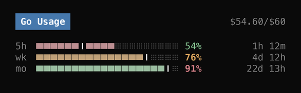
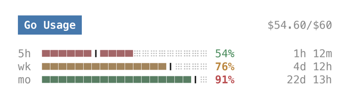

# OpenCode Go Usage

A lightweight [OpenCode](https://opencode.ai) TUI sidebar plugin that displays your **OpenCode Go** subscription quota (`5h` rolling, `wk` weekly, and `mo` monthly) alongside a **theoretical time-progress marker (`┃`)** so you can tell at a glance whether your actual consumption is ahead of or behind schedule.

一个轻量级的 OpenCode TUI 侧边栏插件，实时展示 **OpenCode Go** 套餐的三个额度窗口（5 小时滚动 / 周度 / 月度），并在进度条上用竖线 `┃` 标出**按时间折算的理论进度**，一眼看出实际消耗是超前还是落后于时间进度。

---

## Preview / 预览

| Dark Mode | Light Mode |
| :---: | :---: |
|  |  |

Preview values are illustrative, not live account data. Regenerate both images with `python3 scripts/render_preview.py` (requires Pillow).

```text
 Go Usage                   $54.60/$60

5h ██████┃████░░░░░░░░░ 54%  1h 12m
wk ███████████████┃░░░░ 76%  4d 12h
mo ██████████████████┃░ 91% 22d 13h
```

- **Header (`Go Usage` + `$used/$limit`)**: Monthly spent and total cap, on a blue brand badge (`#4678ac` with white ink, 4.62:1 contrast) so the header never competes with a status colour.
- **Two independent colour channels**:
  - **Percentage text = quota pressure.** Green below 75%, yellow from 75% to 90%, red at 90% and above. Warning and error values are drawn bold.
  - **Bar fill = pace.** Green when usage is more than 2 percentage points behind the `┃` line, yellow when within 2 points (including exactly on the line), red once usage passes the line. During the first 5% of a window the bar stays green while usage is below 10%, so one early request does not flash red.
- **Colour source**: `text.feedback.success` / `warning` / `error` from the active theme. The fill keeps 40% of the token's HSL saturation and the percentage text keeps 70%; hue and lightness are preserved, so both channels follow dark and light themes without hard-coded hex values.
- **`┃` Vertical tick**: Theoretical progress based on elapsed time in that window (`(now - startsAt) / (resetsAt - startsAt)`).
  - Filled bar **left** of `┃` → spending slower than time elapsed (safe pace).
  - Filled bar **right** of `┃` → spending faster than time elapsed.
  - The 2-point pace band is measured in percentage points (`used% - theory%`), not bar cells. At 20 cells wide one cell is 5 points, so the bar can turn yellow before the fill visibly touches `┃`.
- **Right columns**: Actual used percentage and remaining time until the window resets (hour precision).

---

## Prerequisites / 前置条件

1. OpenCode **V2** (`>= 2.0`) with an active **OpenCode Go** subscription.
2. Logged into **OpenCode Console** via `/connect` in the TUI (the plugin reads the local `opencode` Console credential via `context.client.credential.list()`).

---

## Installation / 安装方法

OpenCode automatically discovers local plugins placed under `~/.config/opencode/plugins/<name>/tui.tsx` — no `cli.json` edits required.

OpenCode 会自动扫描 `~/.config/opencode/plugins/<目录>/tui.tsx` 下的本地插件，无需修改配置文件，放好文件重开 TUI 即生效：

```bash
git clone https://github.com/bazuhq/opencode-go-usage.git ~/.config/opencode/plugins/go-usage
```

Or copy [`tui.tsx`](./tui.tsx) directly into `~/.config/opencode/plugins/go-usage/tui.tsx` and restart OpenCode TUI.

---

## How It Works & Privacy / 原理与隐私说明

- **Single file, zero external dependencies**: [`tui.tsx`](./tui.tsx) uses only `@opencode/plugin/tui` and `solid-js` provided by the OpenCode runtime.
- **Read-only & local**: Reads your local Console token in memory from the OpenCode client and sends a `GET` request directly to `https://opencode.ai/console/api/go/status` every 60 seconds and after each completed turn (`session.execution.succeeded`). No data is written to disk or sent anywhere else.

---

## Disclaimer / 免责声明

This plugin queries OpenCode Console's internal `/console/api/go/status` endpoint, which is not a public, versioned API. If OpenCode changes that endpoint or its authentication flow in a future release, the widget will simply display `offline` or `/connect to re-link` without affecting your session. Shared as-is for personal convenience, with no maintenance guarantees.

本插件调用的是 OpenCode Console 网页端自用的内部接口 `/console/api/go/status`（非官方公开承诺稳定的 API）。若未来官方调整接口或鉴权方式，插件只会安静回退显示 `offline`，不影响正常对话。纯个人自用顺手分享，随缘维护。

---

## License

[MIT](./LICENSE)
